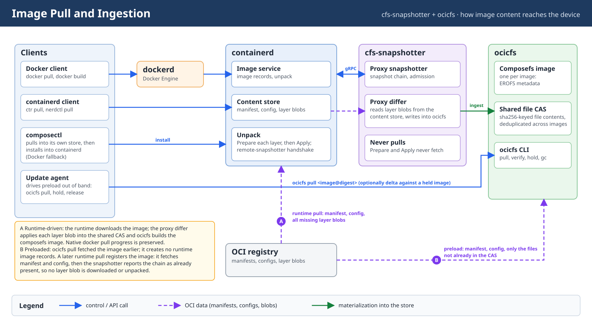
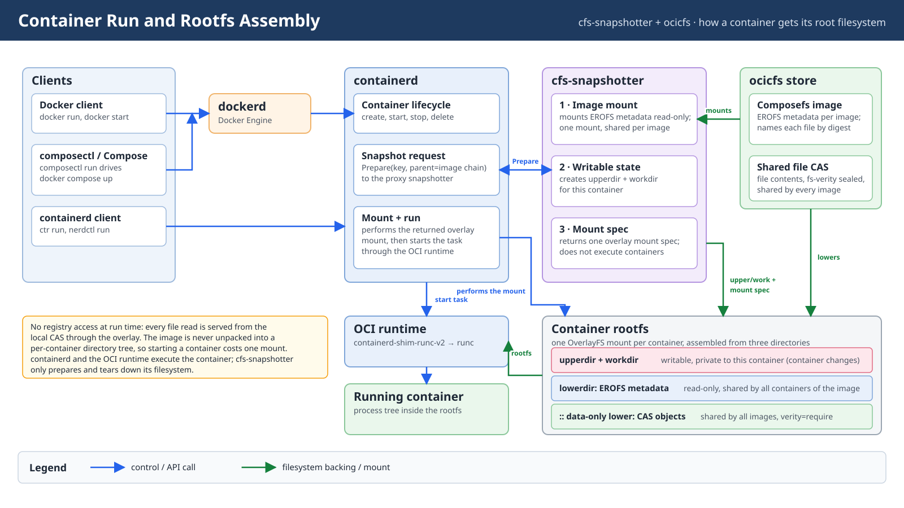

<!-- SPDX-License-Identifier: Apache-2.0 -->

# Architecture overview

How cfs-snapshotter and ocicfs fit into Docker and containerd. For
installation see [INSTALL.md](../INSTALL.md); for day-to-day operation
see [running.md](running.md).

## 1. Overview

| Component | Role |
|---|---|
| Docker / containerd | Standard OCI image and container lifecycle. Docker clients talk to dockerd, which uses containerd; `ctr`, `nerdctl` and CRI talk to containerd directly. |
| cfs-snapshotter | The `containerd-cfs-grpc` daemon: a containerd proxy snapshotter that prepares container filesystems, and a proxy differ that feeds pulled layers into the store. |
| ocicfs | The shared store at `/var/lib/ocicfs`: one content-addressed file store (CAS) for all images, plus one composefs image per OCI image, holding that image's file tree as EROFS metadata. |
| OverlayFS | The container rootfs: one overlay mount per container, combining the read-only image (metadata plus shared file contents) with that container's writable upper directory. |

Images stay standard OCI images. The device never keeps an unpacked copy
of an image; the kernel assembles the rootfs from the store at mount time.

## 2. Image pull and ingestion

Image content reaches the store on one of two paths. Both leave the same
layout on disk, and cfs-snapshotter itself never contacts a registry.

**Runtime-driven ingestion (path A).** Docker or containerd downloads the
manifest, config and layer blobs into containerd's content store, as for
any pull. For each layer, containerd asks the snapshotter to prepare a
snapshot and the differ to apply the blob. The cfs differ reads the blob
from the content store and writes its files into the ocicfs CAS; when the
last layer is applied, ocicfs builds the image's composefs metadata and
records the image. Native `docker pull` progress is preserved.

**Preloading (path B).** An update agent runs `ocicfs pull` out of band.
ocicfs fetches the manifest and config and then only the files the CAS
does not already hold, using `--delta` against a held image where the
layers are zstd:chunked. This creates no image records in the runtime.
Registering the image is a separate, later runtime pull of the same
reference: containerd still fetches the index, manifest and config, but
the snapshotter reports each layer chain as already present, so no layer
blob is downloaded or unpacked.

`composectl` can also download images into its own store and install
them directly into containerd on supported configurations, falling back
to Docker otherwise.

Which paths a daemon admits is a configuration choice; see
[running.md](running.md#pulling-without-staging-first) for the admission
modes, preloading and offline archive loads.

## 3. Container run and rootfs assembly

Docker clients, including `composectl run`, which starts apps with
`docker compose up`, send requests to dockerd, and dockerd drives
containerd. Direct containerd clients such as `ctr` call containerd
itself. Either way, containerd owns the container lifecycle and asks
cfs-snapshotter to prepare the container's filesystem.

On that request the snapshotter does three things:

1. Mounts the image's EROFS metadata read-only on a loop device, once per
   image chain, shared by all containers of that image.
2. Creates an empty upper and work directory for this container.
3. Returns a single overlay mount specification to containerd.

containerd performs the mount. The result is one OverlayFS mount per
container, with no further filesystem stacked on top:

| Layer | Contents | Shared with |
|---|---|---|
| `upperdir` / `workdir` | This container's writes | Nobody |
| `lowerdir` | The image's EROFS metadata: names, permissions, ownership, and a content digest for each file | All containers of the image |
| `::` data-only lower | The ocicfs CAS: the file contents themselves | All images on the device |

The snapshotter does not mount a composefs filesystem and then stack a
container overlay on top of it. The EROFS metadata and the CAS are the
lower layers of the container's own overlay, so the kernel resolves each
file name in the metadata to its content in the CAS directly. With
fs-verity enabled, the mount carries `verity=require` and the kernel
rejects a backing file whose contents do not match the recorded digest.

containerd then starts the task through the OCI runtime
(`containerd-shim-runc-v2` and `runc`). cfs-snapshotter does not execute
containers; it only prepares and later tears down their filesystems.
Normal container execution needs no registry access: every file read is
served from the local store through the overlay.

## 4. Architectural responsibilities

| Responsibility | Owner |
|---|---|
| Image references, pull, image records, container lifecycle | Docker / containerd |
| Downloading manifests, configs and layer blobs during a runtime pull | containerd |
| Applying pulled layer blobs into the store | cfs-snapshotter (proxy differ) |
| Preparing, mounting and removing container filesystems | cfs-snapshotter (proxy snapshotter) with containerd executing the mounts |
| Shared file CAS, per-image composefs metadata, delta pull, store holds and garbage collection | ocicfs |
| Serving the rootfs and enforcing fs-verity on reads | Linux kernel (OverlayFS, EROFS, fs-verity) |
| Running containers | containerd and the OCI runtime |
| Version selection, activation, rollback, update orchestration | The update agent, outside both projects |
